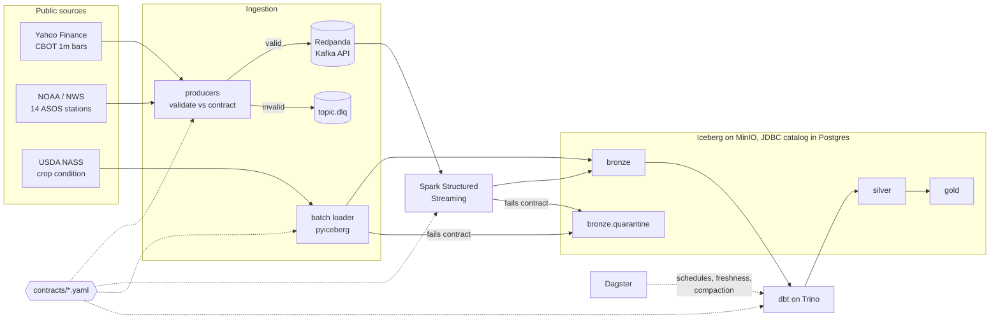

# grainflow

A streaming lakehouse for grain markets. It pulls CBOT futures, corn belt
weather and USDA crop condition into Apache Iceberg. It enforces one set of
data contracts from the producer to the gold tables. The output is a weekly
mart that asks a real question: **does a drop in crop ratings show up in next
week's corn price?**

Everything runs on a laptop with `docker compose`, using public data and no
paid services.



## What's in here

| Layer | Tech | What it does |
| --- | --- | --- |
| Contracts | YAML + JSON Schema | One file per dataset: fields, types, ranges, allowed values, topic, table, partitioning, freshness SLA |
| Ingestion | Python, confluent-kafka | Live 1m futures polling (or sped-up replay), NWS polling, NASS batch loads |
| Streaming | Spark Structured Streaming | Kafka → Iceberg bronze, re-validates every row, routes failures to quarantine |
| Storage | Iceberg v2, MinIO, Postgres | Day-partitioned bronze tables; one catalog shared by Spark, Trino and pyiceberg |
| Transform | dbt on Trino | Incremental dedupe in silver; gold facts with enforced model contracts |
| Orchestration | Dagster | Asset lineage from Kafka to gold, contract-driven freshness checks, nightly compaction |
| CI | GitHub Actions | Lint, 41 unit tests incl. PySpark, 57 dbt nodes on DuckDB, contract compatibility gate |

## Quickstart

You need Docker with ~6 GB of memory, plus [uv](https://docs.astral.sh/uv/) for local development.

```bash
cp .env.example .env        # add a free NASS key + your email for the NWS user agent
make up                     # builds images, creates tables + topics, starts everything
make backfill               # 2y of daily prices, 2 days of weather, crop condition
make transform              # dbt build now instead of waiting for the 15-min schedule
make query                  # weekly corn belt mart via Trino
```

| UI | URL |
| --- | --- |
| Dagster (lineage, runs, checks) | http://localhost:3000 |
| Redpanda Console (topics, DLQ, schemas) | http://localhost:8088 |
| Trino | http://localhost:8080 |
| Spark UI (streaming queries) | http://localhost:4040 |
| MinIO (Iceberg files) | http://localhost:9001 (`grainflow` / `grainflow-secret`) |

If CBOT is closed (weekends, or the daily break), stream the last few days at 60x speed instead:

```bash
docker compose run --rm cli grainflow produce prices --mode replay --speed 60
```

Without Docker, everything except the live stack runs locally:

```bash
make setup
make check                  # lint, contracts, unit tests, dbt build on DuckDB fixtures
```

## Design decisions

**Contracts are the single source of truth.** `contracts/price_bar.yaml` drives
producer validation, the JSON Schema in the registry, Spark's read schema and
checks, the Iceberg table definition, dbt source tests and docs
(`_sources.yml` is generated, and CI fails if it's stale), and the Dagster
freshness checks. A pull request that removes a field, narrows an enum or
makes a field required fails CI unless the contract version is bumped.
→ [ADR 0002](docs/adr/0002-contracts-as-code.md)

**At-least-once into bronze, dedupe in silver.** `foreachBatch` can replay a
micro-batch after a crash. Exactly-once sinks would add a lot of complexity.
Instead, `stg_price_bars` is an incremental model that keeps the newest copy
per natural key, with a one-hour lookback for late duplicates. The fixtures
include a replayed bar so CI proves it.
→ [ADR 0003](docs/adr/0003-at-least-once-delivery.md)

**Bad data is quarantined, never dropped.** There are three gates. Producers
send invalid records to `<topic>.dlq` with the errors in a header. Spark and
the batch loader re-check rows and write failures to `bronze.quarantine` with
the raw payload. `gold.rpt_quarantine_daily` turns that into a trend.

**Iceberg with a JDBC catalog.** Spark, Trino and pyiceberg all point at the
same Postgres tables, with no Hive metastore and no extra service. In AWS this
becomes Glue or a REST catalog (Polaris), and no model code changes.
→ [ADR 0001](docs/adr/0001-iceberg-jdbc-catalog.md)

**Domain logic lives in SQL where analysts can read it.** Corn growing degree
days use the 86/50 method (a dbt macro). Precipitation is deduplicated per
station-hour, because ASOS "special" reports would otherwise double-count rain.
Station-days with fewer than 18 hours of readings are excluded from state
averages.

## Data model

```
bronze  price_bars, weather_observations, crop_condition, quarantine      (Iceberg, contract-shaped)
silver  stg_price_bars (incremental), stg_weather_observations,
        stg_crop_condition, int_weather_station_daily, ref_symbols
gold    fct_price_daily            returns, 20d realized vol
        fct_weather_state_daily    tmin/tmax, GDD, precip per state
        fct_crop_condition_weekly  rating mix, condition index, week-over-week change
        mart_corn_belt_weekly      price + GDD + ratings + next week's return
        rpt_quarantine_daily       rejected records by contract and reason
```

Gold models use dbt's enforced contracts, so a type change fails the build
instead of reaching a dashboard or the agent in project 2.

## Repo layout

```
contracts/            one YAML per dataset
src/grainflow/        contracts, publisher, sources, lake (pyiceberg), CLI, dbt source generator
  orchestration/      Dagster assets, checks, jobs, schedules
spark/                streaming job + image
transform/            dbt project (Trino in the stack, DuckDB in CI)
infra/                Trino catalog, Postgres init, Dagster instance config
scripts/              synthetic fixture generator for CI
tests/                unit tests: contracts, producers, sources, lake, Spark logic, Dagster graph
docs/adr/             decision records
```

## How this maps to production

| Local | AWS equivalent |
| --- | --- |
| MinIO | S3 |
| Iceberg JDBC catalog (Postgres) | Glue Data Catalog or Apache Polaris; Lake Formation for access |
| Redpanda | MSK, or Confluent Cloud with Schema Registry |
| Spark `local[2]` container | EMR Serverless or Databricks job cluster |
| Trino | Athena, or Starburst for the same SQL |
| Dagster OSS | Dagster+ or ECS tasks |
| `docker compose` | Terraform (on the roadmap) |

## Limits

- Yahoo Finance quotes are delayed and unofficial. They're fine for a demo,
  but not for trading.
- NASS crop condition is only published during the growing season
  (roughly April to November).
- The CI fixtures are synthetic: random walks with a fixed seed. They test
  logic, not insight.

## Roadmap

- WASDE monthly PDFs → LLM extraction to contract-validated tables, plus
  embeddings with per-chunk versioning, so only changed text is re-embedded
- Terraform for the AWS layout above
- Project 2: an MCP server so an agent can query the gold layer through
  governed metrics instead of raw SQL
